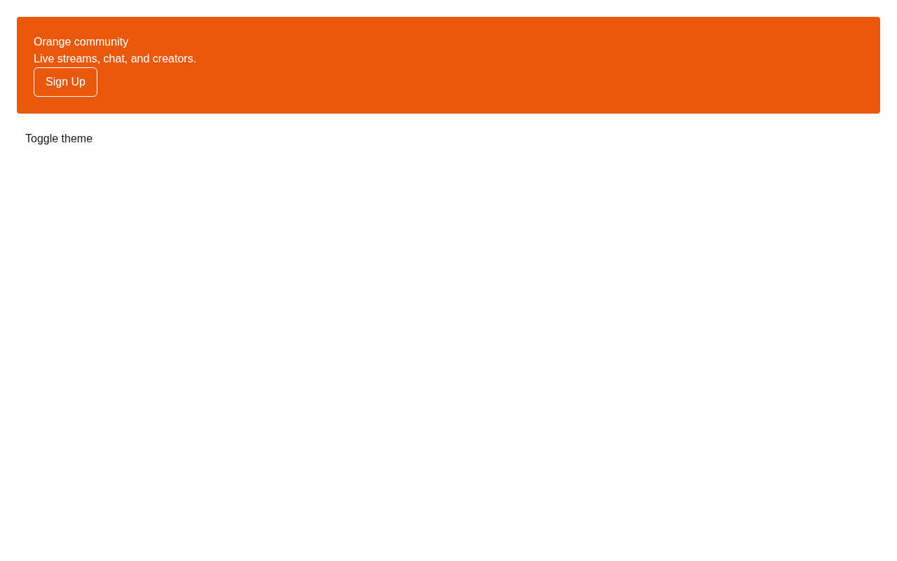
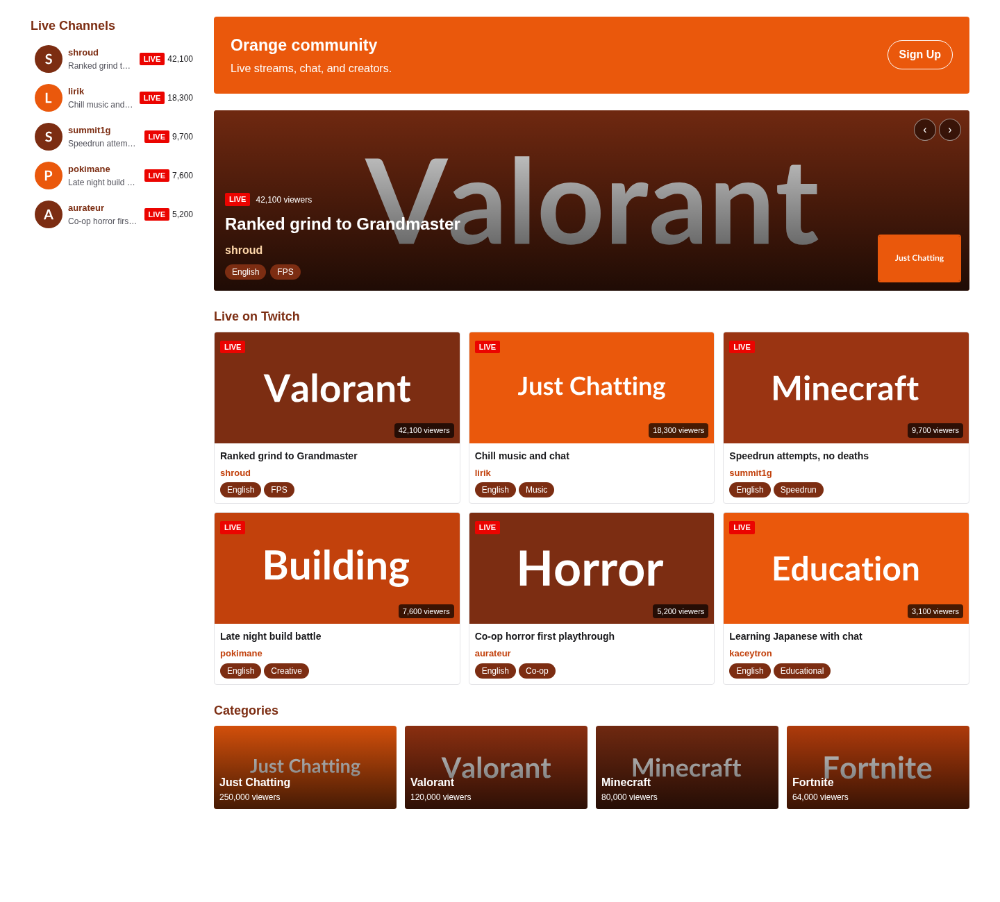
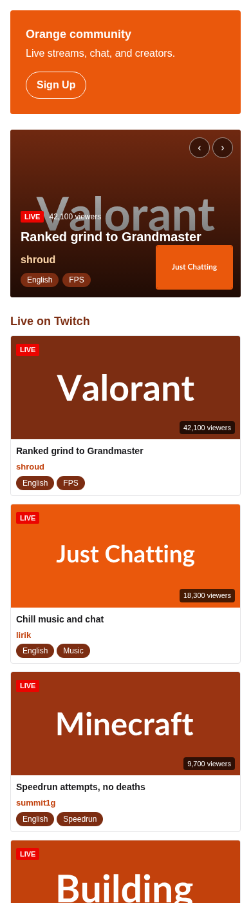
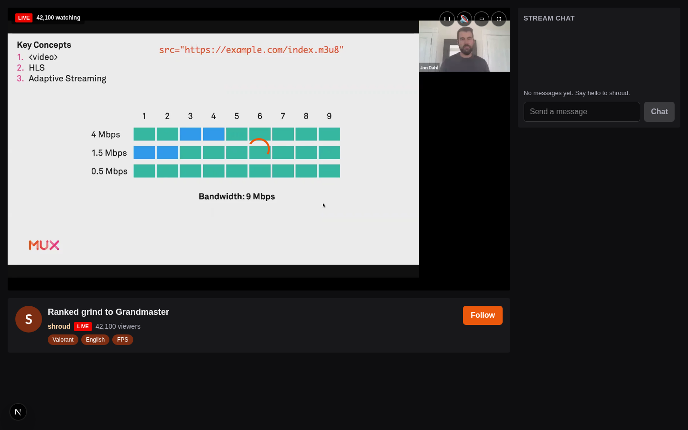

# breach

An orange-themed Twitch clone built with Next.js 15, Mux for live streaming, Supabase for real-time chat, and R2 for emote storage.

## Features

- **Live streaming** — Go live with RTMP ingest via Mux, auto VOD archive on stream end
- **Real-time chat** — Supabase Realtime broadcast with presence, emotes, rate limiting, slow mode
- **Browse & discover** — Hero carousel, live sidebar, video grid, category tiles, search
- **Creator studio** — Stream key management, emote upload/moderation, channel settings
- **Moderation** — Ban, timeout, delete messages, mod action log
- **Follow & notifications** — Follow channels, live notifications, following sidebar
- **Accessibility** — WCAG AA contrast, keyboard navigation, reduced motion, screen reader support
- **Dark mode** — System-aware with manual toggle, orange accent tokens

## Tech stack

| Layer | Technology |
|-------|------------|
| Framework | Next.js 15 (App Router, React 19, Server Components) |
| Streaming | Mux (live ingest, HLS playback, webhooks, VOD) |
| Database & Auth | Supabase (Postgres, RLS, Realtime, Auth) |
| Emote storage | Cloudflare R2 (presigned uploads, CDN delivery) |
| Styling | Tailwind CSS v4, design tokens, CSS variables |
| Type safety | TypeScript strict, Zod schemas at boundaries |
| Lint/format | Biome |
| Testing | Vitest + React Testing Library |
| CI | GitHub Actions (typecheck, lint, test, boundaries) |

## Quick start

### Prerequisites

- Bun v1.4+
- Supabase project (local or cloud)
- Mux account
- Cloudflare R2 bucket (for emotes)

### Environment variables

Copy `.env.example` to `.env.local` and fill in:

```bash
# Supabase
NEXT_PUBLIC_SUPABASE_URL=
NEXT_PUBLIC_SUPABASE_ANON_KEY=
SUPABASE_SERVICE_ROLE_KEY=

# Mux
MUX_TOKEN_ID=
MUX_TOKEN_SECRET=
MUX_WEBHOOK_SECRET=
MUX_SIGNING_KEY=

# Encryption (stream keys at rest)
STREAM_KEY_SECRET=

# R2 (emotes)
R2_ACCOUNT_ID=
R2_ACCESS_KEY_ID=
R2_SECRET_ACCESS_KEY=
R2_BUCKET_NAME=
R2_PUBLIC_URL=
```

### Install & run

```bash
bun install
bun run dev
```

Open http://localhost:3000

### Type check, lint, test

```bash
bun run check      # all gates
bun run typecheck  # TypeScript
bun run lint       # Biome
bun run test       # Vitest
bun run format:check
```

## Project structure

```
app/                    # Next.js App Router pages
  (browse)/             # Public browse routes
  (watch)/              # Watch/channel routes
  studio/               # Creator dashboard
  api/                  # API routes (Mux webhook, emote upload)
features/               # Vertical feature slices
  browse/               # Home, carousel, grid, sidebar, categories
  stream/               # Player, go-live, webhooks, encryption
  chat/                 # Realtime, presence, emotes, rate-limit
  channel/              # Channel data, repositories
  emotes/               # Upload, moderation, CDN
  follow/               # Follow toggle, sidebar, notifications
  search/               # Search channels & categories
  moderation/           # Ban, timeout, mod log
  studio/               # Dashboard, stream key, settings
shared/
  design-tokens/        # Orange ladder, radii, color-mix tokens
  ui/                   # Button, Input, TagPill, LiveBadge
  db/                   # Supabase client, schema
  lib/                  # Logger, a11y helpers
scripts/                # Boundary checks, CI helpers
```

## Architecture

Vertical slices — each feature owns its types, schema, use cases, UI, hooks, and repository adapter. Shared code lives in `shared/` with strict boundary rules enforced by `scripts/check-boundaries.mjs`.

Repository ports define the contract; adapters swap between in-memory (tests), Supabase (prod), and Mux (streaming).

## Screenshots

### Home

| Home |
|------|
|  |

### Browse (PR-03)

| Home | Mobile |
|------|--------|
|  |  |

### Watch (PR-04)

| Player |
|--------|
|  |

### Studio (PR-05)

> Screenshot pending — studio/go-live page requires Supabase/Mux configuration

## Demo video

<video src="media/demo/breach-demo.mp4" controls width="800" poster="media/demo/breach-demo-poster.png">
  Your browser does not support the video tag.
</video>

*Demo showing: Home page → Browse page with live streams & categories → Watch page (shroud) → Studio/go-live page*

## Demo videos

Videos are hosted as PR review comments on GitHub. To add a video:

1. Record a screen capture of the feature
2. Paste the video file directly into a PR review comment on GitHub
3. GitHub will upload it and generate a CDN URL
4. Update this table with the comment URL (format: `https://github.com/paramcodes/breach/pull/<PR>#issuecomment-<ID>`)

| Feature | Video |
|---------|-------|
| Browse & discover | [Watch on GitHub](https://github.com/paramcodes/breach/pull/3#issuecomment-XXXXXX) |
| Watch live stream | [Watch on GitHub](https://github.com/paramcodes/breach/pull/4#issuecomment-XXXXXX) |
| Go live flow | [Watch on GitHub](https://github.com/paramcodes/breach/pull/5#issuecomment-XXXXXX) |
| Real-time chat | [Watch on GitHub](https://github.com/paramcodes/breach/pull/6#issuecomment-XXXXXX) |
| Emote upload & moderation | [Watch on GitHub](https://github.com/paramcodes/breach/pull/7#issuecomment-XXXXXX) |
| Full end-to-end | [Watch on GitHub](https://github.com/paramcodes/breach/pull/12#issuecomment-XXXXXX) |

> Replace `XXXXXX` with the actual comment ID from the PR review where you pasted the video.

## Contributing

1. Fork the repo
2. Create a feature branch
3. Make your changes
4. Run `bun run check` — all gates must pass
5. Open a PR

See [CONTRIBUTING.md](CONTRIBUTING.md) for details.

## License

MIT — see [LICENSE](LICENSE) for details.

## Code of conduct

See [CODE_OF_CONDUCT.md](CODE_OF_CONDUCT.md).

## Security

See [SECURITY.md](SECURITY.md) for reporting vulnerabilities.

## Links

- [Mux live streaming docs](https://www.mux.com/live)
- [Supabase Realtime](https://supabase.com/docs/guides/realtime)
- [Twitch design reference](https://blog.twitch.tv/en/2019/12/03/beyond-purple/)

## Repository topics

Add these topics to the GitHub repository About section:

```
twitch-clone live-streaming mux supabase realtime nextjs react typescript tailwindcss r2 emotes chat
```

## Release tags

Releases are tagged as `v<run_number>` on every successful merge to `main` via GitHub Actions. See [CHANGELOG.md](CHANGELOG.md) for release history.

To view all tags:
```bash
git tag -l "v*"
```